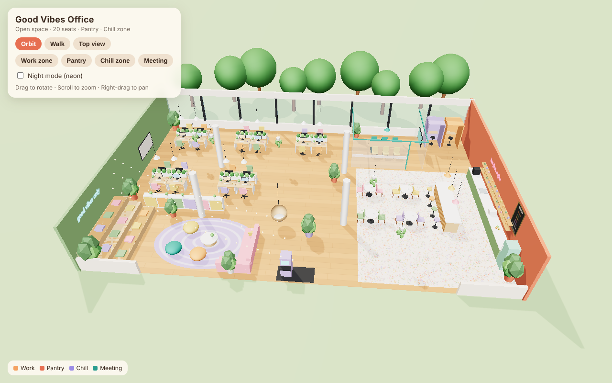
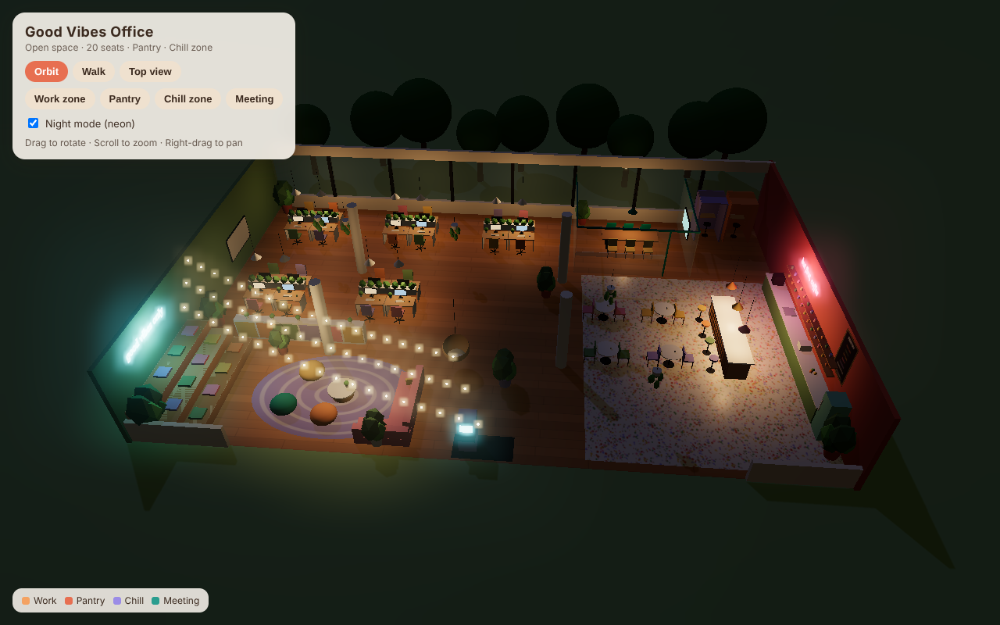

# Good Vibes Office

An interactive 3D open-space office with a Gen Z cafe theme, built for a team of 20.
It runs in any modern browser and is a plain static site (HTML + JS + three.js), so it
deploys to Vercel with zero configuration.



## What's inside

| Zone | What you'll find |
| --- | --- |
| **Work zone** | 5 pods x 4 desks = **20 seats**, each with monitor, colourful chair and a planter divider |
| **Pantry / cafe bar** | Long counter, coffee machine, sink, retro mint fridge, island bar with 4 stools, menu board, "but first, coffee" neon |
| **Cafe tables** | 4 round tables (8 seats) on a terrazzo floor for casual lunch and chats |
| **Chill zone** | Bleacher steps with cushions, pink L-sofa, bean bags, hanging egg chair, arcade cabinet, string lights, "good vibes only" neon |
| **Meeting room** | Glass room with a 6-seat table and TV screen |
| **Focus booths** | 2 phone / focus booths for calls |

Mood-boosting touches: warm pastel palette, lots of plants (biophilic design), daylight
from a full window wall, warm pendant lighting, and a **Night mode** that switches on
the neon signs and string lights.



## Controls

- **Orbit**: drag to rotate, scroll to zoom, right-drag to pan
- **Walk**: first-person, WASD / arrow keys, mouse to look, Shift to run, Esc to exit (desktop only)
- **Top view**: floor-plan view from above
- **Zone buttons**: fly the camera to Work, Pantry, Chill or Meeting
- **Night mode**: neon + bloom lighting

## Run locally

Any static file server works. For example:

```bash
npx serve .
# or
python3 -m http.server 8080
```

Then open http://localhost:8080 (opening `index.html` directly from disk will not work,
because browsers block ES modules on `file://`).

## Deploy to Vercel

1. Go to https://vercel.com and sign in with GitHub.
2. Click **Add New... > Project**.
3. Find **office-open-space** in the list and click **Import**.
   (If it isn't listed, click "Adjust GitHub App Permissions" and give Vercel access to this repo.)
4. Leave the settings as they are:
   - Framework Preset: **Other**
   - Build Command: *(empty)*
   - Output Directory: *(empty, the repo root is used)*
5. Click **Deploy**. After about 30 seconds you get a link like
   `https://office-open-space.vercel.app`.

Every push to `main` redeploys automatically.

## Project structure

```
index.html        page + UI
style.css         UI styling
main.js           the whole 3D scene (layout, furniture, lighting, controls)
vendor/three/     three.js r160 (bundled locally, MIT licence)
docs/             preview screenshots
```

To change the layout, edit `main.js`. Each zone has its own clearly labelled section
(`WORK ZONE`, `PANTRY`, `CHILL ZONE`, ...), and the colour palette is at the top in `PALETTE`.
